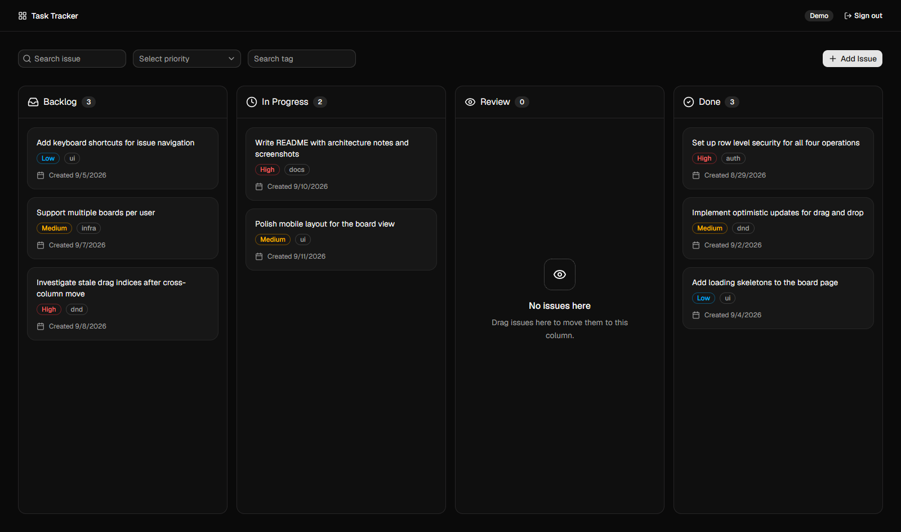

# Task Tracker

A Kanban board for tracking issues: drag and drop between columns, filtering, per-user boards behind Google sign-in.

**[Live demo](https://task-tracker-khat.vercel.app)** — the login screen has a demo button that signs you in anonymously with a pre-seeded board, no account needed.



Lighthouse on desktop: 97 performance, 100 accessibility, 100 best practices, 100 SEO.

## Stack

- React 19, TypeScript, Vite
- Redux Toolkit + RTK Query
- Supabase (PostgreSQL, Auth, Row Level Security)
- @dnd-kit 0.5
- Tailwind CSS v4, shadcn/ui (Radix)
- React Hook Form + Zod
- React Router v7
- Deployed on Vercel

## Getting started

Requires Node 20.19+ and a Supabase project.

```bash
git clone https://github.com/Khat4668/task-tracker.git
cd task-tracker
npm install
cp .env.example .env   # fill in your Supabase URL and anon key
npm run dev
```

The database needs an `issues` table and a `seed_demo_board` function. There are no migration files in the repo (see Known limitations).

## Engineering decisions

### Optimistic drag and drop, pessimistic delete

Dragging a card patches the RTK Query cache before the server responds (`updateQueryData`, reverted with `patchResult.undo()` on failure). Waiting for the round trip made the card snap back to its original column and then jump again once the response arrived. The mutation deliberately has no `invalidatesTags`: the cache is already correct, and a refetch would only cost a request and a flicker.

Not every drop is a change. On drop the card's index in the optimistic state is compared against the index it would hold in the server data. If they match, the card was dropped where it started and no mutation is sent.

Deleting an issue does not need any of this. The confirmation dialog is followed by a redirect to the board, so there is no view left to keep smooth. Delete uses `invalidatesTags` and refetches once the server confirms.

### Pointer activation

The default 5px activation distance broke click-to-open on trackpads: a tap produces enough movement to start a drag, and the drag swallows the click. Touch and mouse need different rules, so the default `PointerSensor` is replaced with one configured per pointer type, using a 250ms delay with 5px tolerance for touch and a 12px distance threshold for mouse and trackpad. Activation is also suppressed on buttons, inputs and selects, so controls inside a card stay usable.

### Row Level Security instead of client-side filtering

The anon key ships in the bundle and is public by design, so anyone can query PostgREST directly and skip the application code entirely. A `.eq('user_id', ...)` filter in the client decides what to render, which is a UX concern rather than a security boundary. Isolation is enforced by RLS policies matching `auth.uid()` from the JWT inside Postgres, where the check cannot be bypassed.

One consequence is worth spelling out. Under RLS, deleting a row the user cannot see returns no error: it simply affects zero rows. `deleteIssue` calls `.select()` and treats an empty result as a failure, otherwise the UI would report success for a delete that never happened.

### Anonymous sessions for the demo

A shared demo account would give every visitor the same board, and the first person to clear it breaks the demo for everyone after them. Supabase anonymous sign-in issues each visitor their own `user_id` with the `authenticated` role, so the existing RLS policies apply unchanged and every demo session is isolated. The board is populated through a `seed_demo_board` RPC.

### RTK Query over the Supabase SDK

RTK Query is used as a server-state cache, not as an HTTP client: request deduplication, tag-based invalidation, optimistic patches, and loading/error flags. Transport is already handled by the Supabase SDK, which builds the PostgREST request and attaches the JWT. `fakeBaseQuery()` disables the built-in transport, and each endpoint uses `queryFn` to call the SDK and return `{ data }` or `{ error }`.

Auth state is bridged into the same cache: `onCacheEntryAdded` subscribes to `onAuthStateChange` and resets `issuesApi` on `SIGNED_OUT`, so one user's board never survives into another session.

TanStack Query would be the more conventional choice for server state alone. Redux Toolkit was picked because it appears more often in the roles this project targets, and the cost of the extra store turned out to be small.

### Fractional positions

Card order is stored as a `position` float rather than an integer index, so moving a card writes a single row instead of renumbering the whole column. New issues take half the current minimum and land at the top.

### Types derived from the database schema

Supabase generates types from the live schema, and application types are built on top of them rather than written by hand: `Issue` is the generated row type, and the update payload is the generated `Update` type minus `id`, `created_at` and `user_id`, which are set by the database and by RLS. Adding a column means regenerating and nothing else.

## Known limitations

- Repeatedly dropping cards into the same gap halves the interval each time and will eventually exhaust float precision. Rebalancing the column is not implemented.
- `createIssue` reads the minimum position and then inserts. That is two round trips, with a window where concurrent creates could collide on the same position. Computing the position in the database would close it.
- RLS policies live in the Supabase dashboard; the repository has no migration files.
